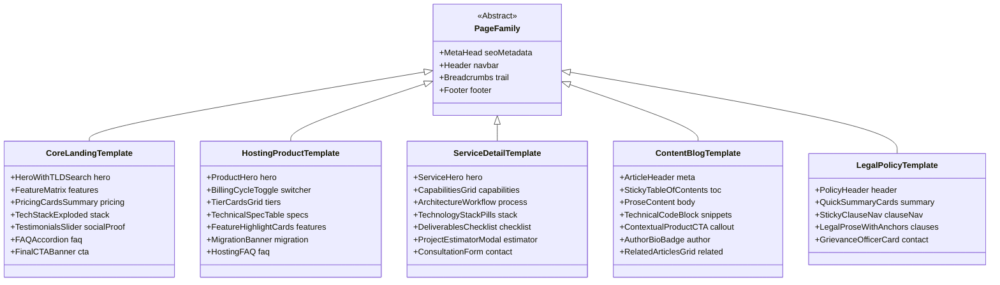
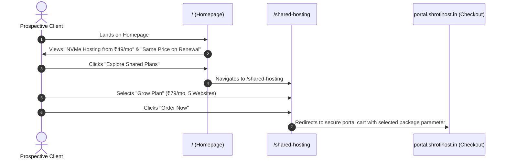
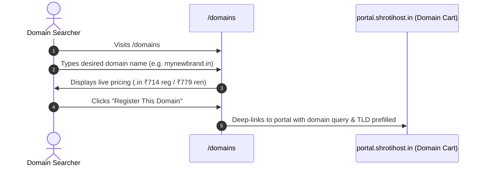
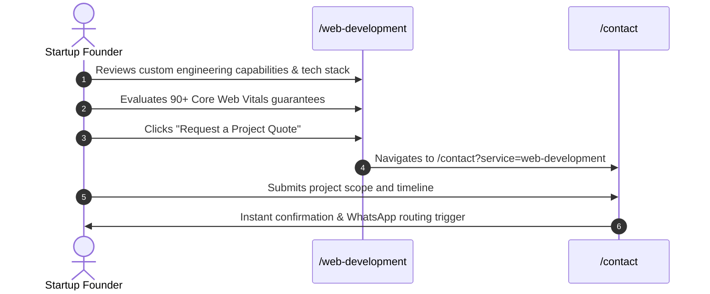

# ShrotiHost – Information Architecture & Sitemap Blueprint

**Author:** Technical Architect & Senior Frontend Engineer  
**Status:** Approved for Implementation  
**Technology Stack:** Next.js (App Router), React, TypeScript, Tailwind CSS, Lucide Icons  
**Canonical Domain:** `https://shrotihost.in`

---

## 1. Architectural Philosophy & Strategy

The information architecture of the redesigned ShrotiHost platform is structured to address two primary business verticals while maintaining a cohesive, unified customer experience:
1. **Cloud Hosting Infrastructure & Domains:** High-velocity self-service purchase flows (Shared, WordPress, Unlimited, Reseller, VPS, Domains).
2. **Custom Software & Web Engineering Services:** High-trust B2B inquiry and consultation flows (Web Development, App Development, SaaS, E-Commerce, WHMCS Plugins).

The redesign eliminates confusing sub-paths, establishes predictable URL hierarchies, preserves 100% of existing search engine equity through explicit canonical paths and 301 redirects, and organizes content into standardized, modular page templates.

---

## 2. Global Website Sitemap

```
https://shrotihost.in/
│
├── / (Homepage - Primary Hub & Value Proposition)
│
├── Hosting (Category: High-Performance Hosting Infrastructure)
│   ├── /shared-hosting (NVMe Shared Hosting - Launch, Grow, Turbo, Infinity)
│   ├── /wordpress-hosting (Managed WordPress Hosting - Starter, Business, Performance, Ultimate)
│   ├── /unlimited-hosting (Unlimited NVMe Hosting - Bronze, Gold, Platinum, Diamond)
│   ├── /reseller-hosting (Reseller Hosting - 25 to Unlimited cPanel Accounts)
│   ├── /master-reseller-hosting (Master Reseller Hosting - Sub-WHM Reseller Authority & Overselling)
│   └── /vps (Cloud VPS Virtual Private Servers - Spark through Apex)
│
├── Domains (Category: Domain Registration & Management)
│   └── /domains (Domain Name Search, TLD Pricing Matrix, Transfer Guide)
│
├── Services (Category: Engineering & Digital Solutions)
│   ├── /services (Services Hub & Engineering Engagement Overview)
│   ├── /web-development (Custom Web Design & Frontend Engineering)
│   ├── /app-development (Cross-Platform iOS & Android Mobile Engineering)
│   ├── /ecommerce-development (High-Converting WooCommerce & Custom Stores)
│   ├── /saas-development (Bespoke Cloud Architecture & Multi-Tenant SaaS)
│   └── /whmcs-modules (WHMCS Modules: WhatsApp Gateway, Surcharge Fees, Social Proof)
│
├── Company (Category: Corporate Identity & Support)
│   ├── /about (Mission, Founder Story, Hathras Registered Office, MSME Credentials)
│   ├── /contact (Department Routing: Sales, Technical Support, Migrations, Billing)
│   └── /careers (Remote-First Engineering & Support Open Roles)
│
├── Resources (Category: Technical Knowledge Hub & Guides)
│   ├── /blog (Technical Articles, Tutorials & Infrastructure Comparisons)
│   ├── /blog/shared-vs-reseller-hosting (Architectural & Business Model Comparison)
│   ├── /blog/when-should-you-upgrade (Five Real Signals to Upgrade to a VPS)
│   ├── /blog/vps-vs-shared-hosting (Resource Isolation & Cost Comparison)
│   ├── /blog/what-is-litespeed-hosting (LiteSpeed Web Server & LSCache Deep Dive)
│   ├── /blog/dns-records-explained (A, AAAA, CNAME, MX, and TXT Practical Guide)
│   ├── /blog/in-or-com-choosing-a-domain-in-india (ccTLD vs gTLD Strategy for Indian Businesses)
│   ├── /blog/10-ways-to-speed-up-wordpress (Production Core Web Vitals Optimization)
│   ├── /blog/website-development-cost (Real Cost Drivers & Budgeting in India)
│   └── /blog/how-to-transfer-a-domain (Zero-Downtime EPP Transfer Walkthrough)
│
└── Legal (Category: Governance, Privacy & Compliance)
    ├── /terms (Terms of Service - Shroti Enterprises & Billing Protocols)
    ├── /privacy (Privacy Policy - Digital Personal Data Protection Act 2023)
    ├── /refund (Refund & Cancellation Policy - 7-Day Money-Back Guarantee)
    └── /acceptable-use-policy (Acceptable Use Policy - Resource & Content Rules)
```

---

## 3. Main Navigation Structure (Header)

The header utilizes a clean, modern sticky navbar with an announcement ticker, brand logo, structured mega-menus, search shortcut, currency switcher, and key action buttons.

```mermaid
graph TD
    Navbar["Sticky Navbar"] --> Logo["ShrotiHost Brand Logo"]
    Navbar --> NavHosting["Hosting Dropdown"]
    Navbar --> NavDomains["Domains Link"]
    Navbar --> NavServices["Services Dropdown"]
    Navbar --> NavCompany["Company Dropdown"]
    Navbar --> NavBlog["Blog Link"]
    Navbar --> Actions["Utility & Actions"]

    NavHosting --> H1["NVMe Shared Hosting (from ₹49/mo)"]
    NavHosting --> H2["Managed WordPress Hosting (from ₹69/mo)"]
    NavHosting --> H3["Unlimited NVMe Hosting (from ₹69/mo)"]
    NavHosting --> H4["Reseller Hosting (from ₹299/mo)"]
    NavHosting --> H5["Master Reseller Hosting (from ₹599/mo)"]
    NavHosting --> H6["Cloud VPS Hosting (from ₹499/mo)"]

    NavServices --> S1["Custom Web Development"]
    NavServices --> S2["Mobile App Development"]
    NavServices --> S3["E-Commerce Development"]
    NavServices --> S4["SaaS & Cloud Engineering"]
    NavServices --> S5["WHMCS Modules & Plugins"]
    NavServices --> S6["All Services Overview"]

    NavCompany --> C1["About ShrotiHost"]
    NavCompany --> C2["Contact & Department Routing"]
    NavCompany --> C3["Careers (We are hiring)"]

    Actions --> CurrencyToggle["Currency (INR / USD / EUR)"]
    Actions --> LoginCTA["Client Portal Login (External)"]
    Actions --> PrimaryCTA["Explore Plans (Anchor / Button)"]
```



### 3.1 Header Micro-Copy & Badge Enhancements
* **Top Announcement Bar:** `⚡ NVMe SSD + LiteSpeed Web Servers | Flat Renewal Guarantee: No Price Hikes | 24/7 WhatsApp Support`
* **Dropdown Feature Badges:** 
  * "Shared Hosting" tagged with `Most Popular for Beginners`
  * "WordPress Hosting" tagged with `Redis & LSCache Included`
  * "Reseller Hosting" tagged with `Free WHMCS License`
  * "VPS Hosting" tagged with `Full Root Access`

---

## 4. Footer Structure

The footer is designed as an authoritative, comprehensive directory that reinforces trust, displays regulatory data, links all 30 routes, and complies with financial transparency requirements.

```
┌─────────────────────────────────────────────────────────────────────────────────────────────┐
│ SHROTIHOST                                                                                 │
│ High-performance cloud hosting, domain registrations, and bespoke software engineering.     │
│ Udyam MSME Registered: UDYAM-UP-36-0017127 | Ruheri, Hathras, Uttar Pradesh 204101, India  │
├─────────────────┬─────────────────┬─────────────────┬──────────────────┬────────────────────┤
│ HOSTING PLANS   │ DOMAINS & TECH  │ SOFTWARE DEV    │ COMPANY & TEAM   │ LEGAL & TRUST      │
├─────────────────┼─────────────────┼─────────────────┼──────────────────┼────────────────────┤
│ Shared Hosting  │ Domain Search   │ Web Development │ About ShrotiHost │ Terms of Service   │
│ WordPress Host  │ Transfer Domain │ App Development │ Contact & Routing│ Privacy (DPDP Act) │
│ Unlimited Host  │ DNS Knowledge   │ E-Commerce Dev  │ Careers (Hiring) │ Refund Policy      │
│ Reseller Host   │ LiteSpeed Tech  │ SaaS Solutions  │ Technical Blog   │ Acceptable Use     │
│ Cloud VPS       │ NVMe SSD Specs  │ WHMCS Modules   │ Client Portal    │ 7-Day Guarantee    │
├─────────────────┴─────────────────┴─────────────────┴──────────────────┴────────────────────┤
│ ACCEPTED PAYMENT CHANNELS: UPI (GPay, PhonePe, Paytm), RuPay, Visa, Mastercard, Net Banking│
│ CONTACT SUPPORT: support@shrotihost.in | WhatsApp: +91 95821 29099 | Mon–Sun 24/7 Response   │
│ © 2026 ShrotiHost, a brand operated by Shroti Enterprises. All Rights Reserved.             │
└─────────────────────────────────────────────────────────────────────────────────────────────┘
```

---

## 5. Page Hierarchy & Reusable Page Families

To ensure rapid frontend rendering, maintainable code architecture, and visual consistency, all 30 routes are categorized into **5 Reusable Page Families**:



### 5.1 Page Family 1: Core Landing Template (`/`)
* **Used By:** Homepage (`/`).
* **Key Components:** Hero banner with instant domain check input, value proposition metrics, tabbed pricing preview, exploded cloud architecture, social proof / Trustpilot reviews, interactive FAQ accordion, high-conversion consultation banner.

### 5.2 Page Family 2: Hosting Product Template
* **Used By:** `/shared-hosting`, `/wordpress-hosting`, `/unlimited-hosting`, `/reseller-hosting`, `/vps`, `/domains`.
* **Key Components:** Breadcrumb trail, product hero with primary value badge (e.g. "Flat Renewal"), interactive billing toggle (Monthly / Semi-Annual / Annual), 4-to-8 tier pricing grid with feature checklist, comprehensive sticky technical specifications table, infrastructure highlights (LiteSpeed, NVMe, JetBackup, Imunify360), free website migration banner, product-specific FAQ.

### 5.3 Page Family 3: Service Detail Template
* **Used By:** `/services`, `/web-development`, `/app-development`, `/ecommerce-development`, `/saas-development`, `/whmcs-modules`.
* **Key Components:** Breadcrumb trail, service hero with project scope badge, core capabilities grid with feature cards, 5-stage development process roadmap (Discovery -> Wireframing -> Code -> QA -> Cloud Launch), supported frameworks and stack badges, project deliverables checklist, interactive project scope inquiry form.

### 5.4 Page Family 4: Content & Technical Knowledge Hub Template
* **Used By:** `/blog`, and all 9 individual blog articles (`/blog/[slug]`).
* **Key Components:** 
  * *Index Page:* Category filter tabs, search bar, featured article spotlight, responsive article grid with reading time, author, and date.
  * *Article Page:* Article metadata header, estimated reading time, sticky interactive Table of Contents, formatted typography with copyable technical code snippets, comparison decision callouts, inline product recommendation banners, author badge (ShrotiHost Technical Team), related articles carousel.

### 5.5 Page Family 5: Legal & Policy Compliance Template
* **Used By:** `/terms`, `/privacy`, `/refund`, `/acceptable-use-policy`.
* **Key Components:** Plain-English summary callout cards at the top ("In Plain English"), sticky side-navigation jumping to specific legal sections, anchored legal clauses, last-updated badge, official MSME entity details, and direct Grievance Officer / Support contact box.

---

## 6. Critical User Journeys & Funnel Mapping

### Journey 1: The Fast-Path Hosting Buyer


### Journey 2: The Domain Registrant


### Journey 3: The Custom Software Prospect


---

## 7. URL Preservation & Canonical Redirect Strategy

To preserve search engine rankings and eliminate broken 404 links from legacy or third-party references, the following permanent 301 redirects are configured in `next.config.ts`:

| Incoming Legacy / Variant URL | Canonical Destination URL | HTTP Status | Rationale |
| :--- | :--- | :---: | :--- |
| `/terms-and-conditions` | `/terms` | 301 Permanent | Canonicalize terms route |
| `/terms-of-service` | `/terms` | 301 Permanent | Canonicalize terms route |
| `/privacy-policy` | `/privacy` | 301 Permanent | Canonicalize privacy route |
| `/refund-policy` | `/refund` | 301 Permanent | Canonicalize refund route |
| `/cancellation-policy` | `/refund` | 301 Permanent | Consolidate refund & cancellation rules |
| `/vps-hosting` | `/vps` | 301 Permanent | Match standard short URL convention |
| `/domain-registration` | `/domains` | 301 Permanent | Consolidate domain search & registration |
| `/domain` | `/domains` | 301 Permanent | Plural consistency |
| `/whmcs` | `/whmcs-modules` | 301 Permanent | Clarify module & plugin offering |
| `/aup` | `/acceptable-use-policy` | 301 Permanent | Expand abbreviation for SEO |

